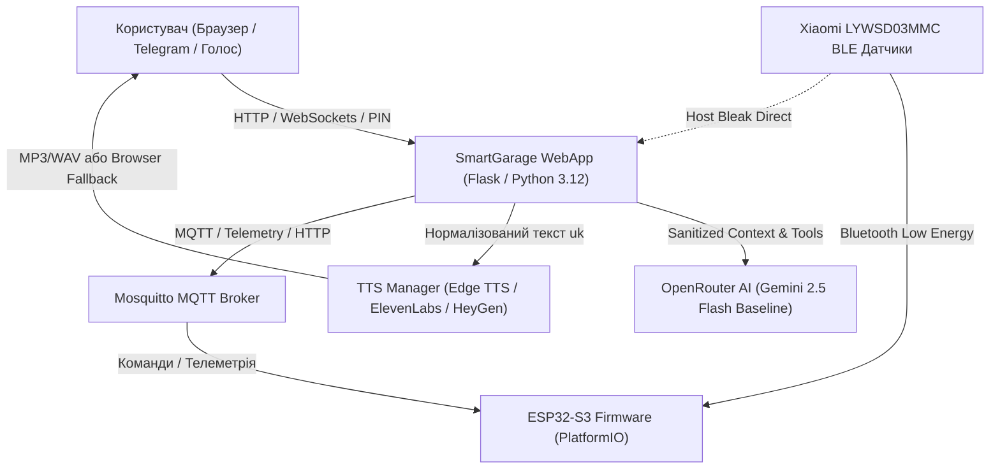

# Smart Garage AI Infrastructure

> **Автономна система розумного гаража та персональний AI-помічник**  
> Проєкт розроблено на базі сучасного стеку Python 3.12, мікроконтролерів ESP32-S3, штучного інтелекту OpenRouter, голосового синтезу мовлення українською мовою та захищеного зв'язку через MQTT, BLE та WebSockets.

---

## 📌 Архітектурний огляд



---

## ⚠️ Чесне зазначення меж безпеки та реального стану обладнання (Truth Architecture)

1. **Привід воріт (Garage Door Drive)**:
   - Фізичний електропривід воріт **не встановлено / відключено** на апаратному рівні.
   - Усі спроби дистанційного відкриття або закриття воріт через AI, голосові команди чи API суворо блокуються з кодом безпеки або повертають помилку `Door drive not installed`.
   - Жоден follow-up запит («спробуй ще раз», «повтори») не є дозволом на небезпечну дію і не може обійти це блокування.

2. **Газовий контроль (MQ Gas Sensor)**:
   - Фізичний датчик загазованості/диму **не змонтовано**.
   - Система чесно фіксує відсутність даних і не генерує фіктивних показників безпеки.

3. **Справжність показань сенсорів (Sensor Freshness & Telemetry Truth)**:
   - 1-й поверх (Гараж): датчик температури відсутній (`installed: false`, статус `not_installed`). Система ніколи не підставляє вигадані або усереднені значення.
   - 2-й поверх та Підвал: дані надходять через BLE. Якщо вимір старіший за 20 хвилин або зв'язок втрачено, сенсор набуває статусу `stale` або `offline`.
   - Застарілі показники ніколи не видаються за поточні (`current_temperature: null`), а відображаються виключно як історичні (`last_known_temperature`) із зазначенням точного часу виміру.

4. **Голосовий TTS та зовнішні API**:
   - Для хмарних моделей (ElevenLabs Flash v2.5, HeyGen Voice Turbo) обов'язково потрібні відповідні API-ключі у файлі `.env`.
   - За замовчуванням система використовує **Microsoft Edge Neural TTS (Поліна)** — високоякісний безкоштовний провайдер, що працює без ключів.
   - Якщо серверний TTS недоступний, браузерний `speechSynthesis` запускається **виключно як явно позначений резерв** з індикатором у вебінтерфейсі.

---

## 🚀 Основні модулі системи

### 1. Вебдіалог, збереження контексту та короткочасні наміри
- **Ізоляція браузерних сесій**: серверна генерація та перевірка криптографічно підписаних `session_id`. Ліквідовано глобальний `web_console`, клієнтські підміни чужих ID блокуються з кодом 403.
- **Валідний цикл tool-call повідомлень OpenRouter**: повідомлення `assistant` із `tool_calls` -> окремі відповіді `tool` для кожного `tool_call_id` -> фінальна відповідь `assistant`.
- **Контрольований Follow-Up**: запити «спробуй ще раз», «повтори», «так само» відновлюють параметри останньої невдалої дії (пісня, станція) без повторного опитування користувача. Повтор успішних дій попереджає про вже досягнутий результат.
- **Персистентність**: сесії автоматично зберігаються на диску в `memory/dialog_sessions.json` та відновлюються після перезапуску сервера.

### 2. Маршрутизація AI та облік витрат (OpenRouter)
- **Конфігурація моделі**: базовою перевіреною моделлю є `google/gemini-2.5-flash`.
- **Санітизація телеметрії**: автоматичне видалення локальних IP-адрес (`192.168.x.x`), MAC-адрес сенсорів, паролів та токенів перед відправкою моделі.
- **Приватність провайдера**: увімкнено політику `provider: {data_collection: "deny"}`.
- **Контроль витрат і лімітів**: щоденний трекінг токенів та витрат у USD (`memory/openrouter_usage.json`) із захисним добовим лімітом (за замовчуванням $1.00/добу) та експоненційним retry/backoff для 429/5xx.
- **Безпека виконання**: у разі збою OpenRouter виключено аварійне передавання запиту до сторонніх інтерпретаторів довільного коду (OpenInterpreter відключено у production).

### 3. Український голосовий синтез (TTS)
- **Модульна архітектура**: інтерфейс `TTSProvider`, нормалізатор українського тексту `server/tts/normalizer.py` (відмінювання чисел, одиниць, збереження апострофів у словах на кшталт `п'ять`), короткоживучий TTL-кеш аудіофайлів.
- **Провайдери**:
  - `edge`: Microsoft Edge Neural TTS (`uk-UA-PolinaNeural`, `uk-UA-OstapNeural`) — безкоштовно, локально/хмарно.
  - `elevenlabs`: ElevenLabs Flash v2.5 (`eleven_flash_v2_5`) — преміум швидкість (~150ms) за тарифом ~$0.04/1k символів.
  - `heygen`: HeyGen Voice Turbo REST (`POST /v3/models/audio/tts`) — 44.1 kHz WAV (безкоштовна квота до 30.11.2026).
  - `browser`: явний резервний синтез Web Speech API у разі недоступності серверних провайдерів.

### 4. Прошивка мікроконтролера (ESP32-S3)
- **Єдине джерело істини**: прошивка збирається через PlatformIO з файлу [`esp32/src/main.cpp`](file:///home/yurko/AI/SmartGarage/esp32/src/main.cpp).
- Застарілі скетчі Arduino IDE архівовано в [`esp32/legacy/`](file:///home/yurko/AI/SmartGarage/esp32/legacy/).
- Підтримка зчитування BLE-датчиків Xiaomi LYWSD03MMC, MQTT-клієнт, USB Serial зв'язок, локальний HTTP-сервер.

---

## 🛠️ Встановлення та запуск

### 1. Клонування та налаштування оточення
```bash
git clone https://github.com/your-repo/SmartGarage.git
cd SmartGarage

# Створення та активація віртуального середовища
python3 -m venv venv
source venv/bin/activate

# Встановлення залежностей
pip install -r requirements-dev.txt
```

### 2. Конфігурація (.env)
Скопіюйте зразок та налаштуйте необхідні параметри:
```bash
cp .env.example .env
nano .env
```
Вкажіть ваш `OPENROUTER_API_KEY`, `FLASK_SECRET_KEY` та, за потреби, `ELEVENLABS_API_KEY` чи `HEYGEN_API_KEY`.

### 3. Docker Compose Профілі
У корені проєкту налаштовано `docker-compose.yml` з підтримкою профілів:
```bash
# Базовий стек (тільки Mosquitto MQTT брокер):
docker compose up -d

# З підключенням швидкого Redis-кешу:
docker compose --profile cache up -d

# З платформою автоматизації n8n:
docker compose --profile automation up -d

# Запуск усіх допоміжних сервісів:
docker compose --profile all up -d
```

---

## 🧪 Тестування та безперервна інтеграція (CI)

Усі тести повністю ізольовані: вони використовують mock-об'єкти для фізичного обладнання, реле, BLE-зв'язку та зовнішніх хмарних API (жодних платних запитів чи фізичних дій під час тестів).

```bash
# Перевірка синтаксису всього коду
python3 -m compileall server tests scripts

# Запуск модульних та інтеграційних тестів (200 тестів)
PYTHONPATH=. pytest -v

# Компіляція прошивки ESP32-S3 через PlatformIO
pio run -d esp32
```

Автоматичний пайплайн GitHub Actions (`.github/workflows/ci.yml`) автоматично перевіряє синтаксис `compileall`, валідність усіх JSON-файлів конфігурації, запускає 200 тестів `pytest` та виконує чисту збірку прошивки `pio run -d esp32` для кожного Pull Request та коміту в гілку `main`.

---

## 📄 Історія змін та версії
Детальний журнал усіх внесених оновлень, виправлень та версій зафіксовано у файлі [`CHANGELOG.md`](file:///home/yurko/AI/SmartGarage/CHANGELOG.md).
